<h1 align="center">Plumemu</h1>

A calm, light launcher for Android retro handhelds.

  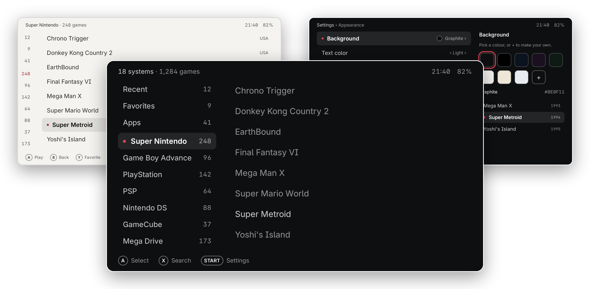

  <b>0.0.7-beta</b> · Android 6.0 or later · tested on the AYN Thor, the Retroid Pocket Nova and the Retroid Pocket Classic ·
  <a href="../../releases">Download</a> · <a href="https://plumemu.stevensdesk.com">Website</a>

  This is a beta: it still has gaps and rough edges, and it is updated often.

---

## Why Plumemu

1. **Your games have names from the first minute, offline.** No account, no scraping, no internet:
   Plumemu reads each game's own code and knows 42,000 arcade sets, so a folder of cryptic files
   becomes a tidy list the moment setup ends.
2. **It works out of the box.** Pick your ROMs folder and you are playing: it finds the emulators
   you have installed, picks one for each system and adds new games by itself. Setup takes two
   minutes.
3. **It is light, even on old handhelds.** An 8.0 MB download that runs on Android 6.0, opens a
   library of 10,000 games in about a quarter of a second and uses no CPU while it waits.
4. **It never touches your files.** It sees only the folder you pick, and never deletes, moves or
   renames a game file.
5. **It uses everything your handheld has.** The second screen shows details and how long your
   battery lasts at this game's pace, and every screen works with both buttons and touch.

## What it does

### Your games, named and in order

- **Names your games itself, offline.** It reads the game's own code inside zip, 7z and CHD files
  and disc images, knows about 42,000 arcade sets by their short names, takes names for newer
  Switch games from GameTDB and cleans up messy file names. Arcade games get a clean name with the
  region in its own column. No account, no internet. A wrong name is fixed from the game menu, and
  the fix sticks.
- **One row per game.** Copies of one game (regions, revisions, arcade sets) show as one row, even
  from separate folders; Other versions in the game menu picks which one plays. Same-name variants
  carry a label (Rev 1, Beta, translation, hack), and `.cue`, `.gdi` and `.m3u` parts are not rows
  of their own.
- **New games show up by themselves.** Copy games in or put in an SD card: they appear when you
  come back to Plumemu, and Home tells you about them. A folder Plumemu cannot place in a system is
  listed in Settings › Library, where you pick its system.
- **Android games and Ports.** Installed Android games get a system of their own, and native port
  apps (Delta Touch and others) join Ports. Show as game, Show as port and Not a game in the menus
  correct Plumemu's choice.
- **Box art, if you want it.** Sign in with your own free
  [ScreenScraper](https://www.screenscraper.fr) account and Plumemu fetches box art and game
  details over Wi-Fi. A wrong cover is replaced from the game menu. The box art panel shows the
  space used and has Clear box art; a daily cleanup removes orphaned images, and games that keep
  failing on the server stop retrying after 3 days.
- **Details and sorting.** Info shows the year, publisher, developer, genre, players and the whole
  description. Sort games has a Year order.

### Playing

- **Emulators picked for you.** Plumemu finds the emulators you have installed and picks one per
  system; any game or system can use another. Each emulator is offered only for the file types it
  opens. If a RetroArch core may be missing, Plumemu asks "Did the game start?" and offers the
  other emulators.
- **Second screen, and your battery.** On a handheld with two screens, like the AYN Thor, the lower
  screen shows the chosen game's details, your statistics while Settings is open, and, while you
  play, a clock with how long the battery lasts at this game's pace. A game you have played says
  "2 h on this charge" before you start it. Everything still works on one screen.
- **Light enough for old handhelds.** An 8.0 MB download that runs on Android 6.0, opens your
  library in about a quarter of a second and uses no CPU while it sits on the home screen.
  [Measured](#light-on-the-hardware) on a slow emulator with 10,000 games.

### Make it yours

- **Colors.** Ten ready-made sets, each previewed before you pick it: Plumemu, Paper, Pocket, Dot
  matrix, Super, Indigo, Charcoal, Ivory, Banana and Cream. Super, Charcoal, Ivory, Banana and
  Pocket color the A, B, X and Y keys. Or make your own background, text and accent colors with
  sliders that show the whole screen in the new color as you drag.
- **Lists or covers.** Show any system, Recent or Favorites as a list or as a grid of covers in
  three sizes. Apps can be a grid of icons too.
- **One sliding view.** Systems, games and details move as one strip, laid out for 16:9 and 4:3
  screens. On 4:3 and narrow screens the game's details peek in beside the list. Beside the games,
  a narrow strip shows game counts, a code per system or a letter rail you can tap or drag.
- **About each system.** Above a system's games, a short band with its badge, the years it was
  made and a few lines about it. Settings › Home screen › System info turns it off.
- **Text you can set.** Text size starts at Large, and Text weight is Thin, Medium or Bold.
- **Sounds and vibration.** Settings › Advanced sets sounds Off, Quiet or Loud (they follow the
  media volume) and vibration, which is on by default. A Language list is there too.
- **Buttons and touch**, equally, everywhere. Plumemu has its own compact keyboard, made for the
  D-pad, so Search keeps its results in view while you type.

### Your files and your data

- **Your files stay yours.** Setup takes two minutes: pick your ROMs folder in Android's own folder
  picker. No access to all your files, ever, and Plumemu never deletes, moves or renames a game
  file.
- **Back up and restore.** Save your settings, or everything (library, box art, play time), into
  one file, checked after writing, and put it back on this device or a new one.
- **Updates from inside the app.** Once a day on Wi-Fi Plumemu looks for a new version; Settings ›
  About › Update installs it.
- **Anonymous usage statistics and crash reports**, to decide what to fix first. Setup asks, and
  Settings › Statistics turns them off at any time. [Privacy](PRIVACY.md) lists what is sent.

  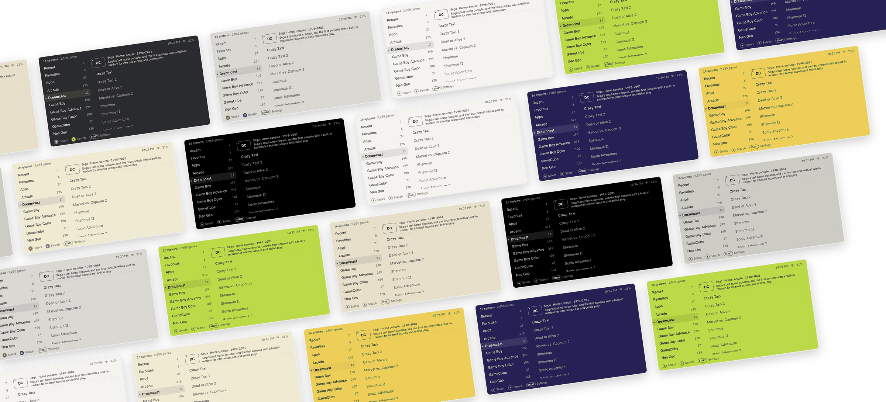

<table>
  <tr>
    <td width="50%">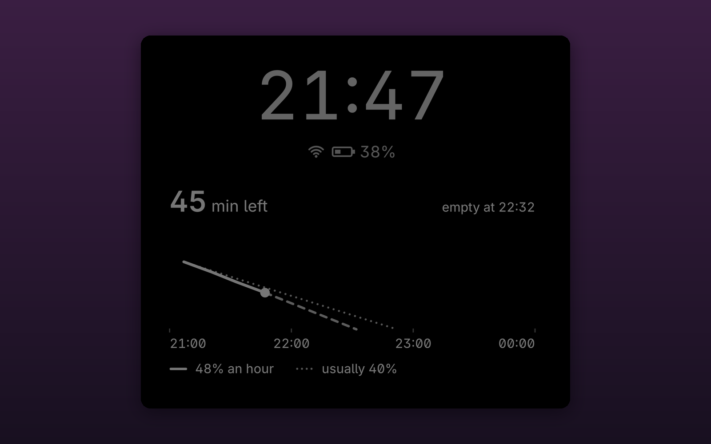</td>
    <td width="50%">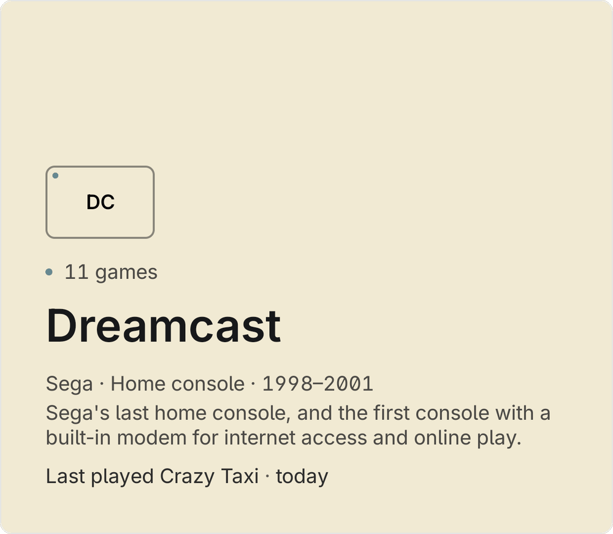</td>
  </tr>
  <tr>
    <td align="center">How long your battery lasts, while you play</td>
    <td align="center">Each system's facts on the second screen</td>
  </tr>
  <tr>
    <td width="50%">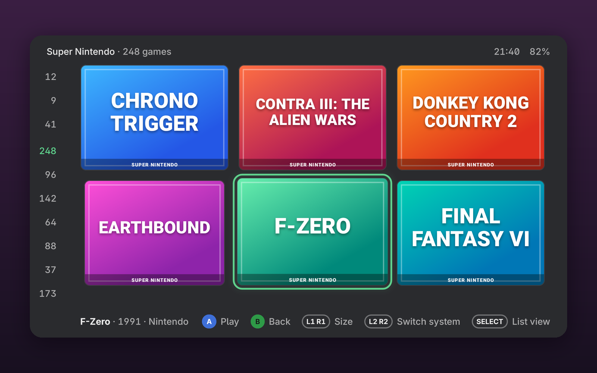</td>
    <td width="50%">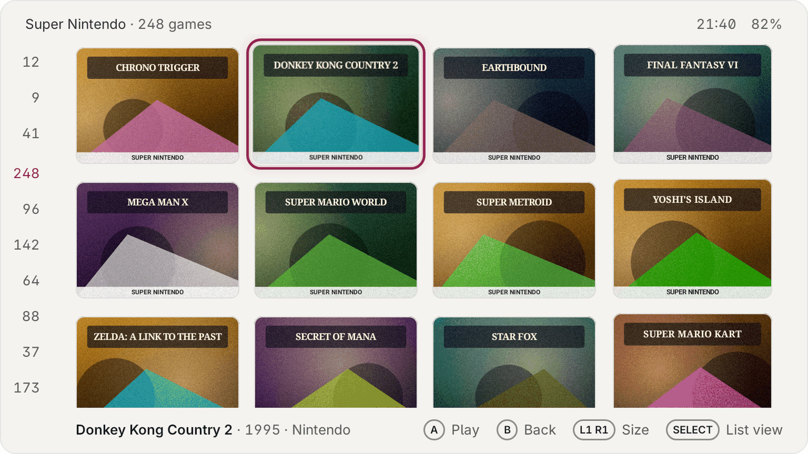</td>
  </tr>
  <tr>
    <td align="center">Any system as a grid of covers</td>
    <td align="center">In three sizes, light or dark</td>
  </tr>
  <tr>
    <td width="50%">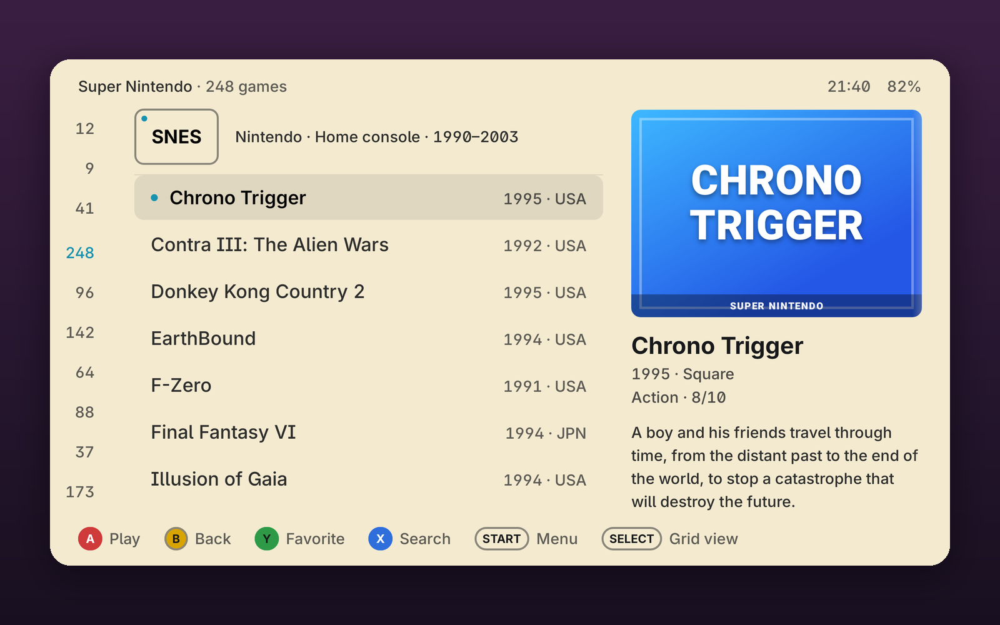</td>
    <td width="50%">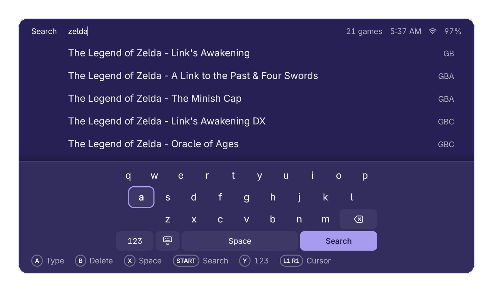</td>
  </tr>
  <tr>
    <td align="center">A few lines about each system</td>
    <td align="center">A keyboard made for the D-pad</td>
  </tr>
  <tr>
    <td width="50%">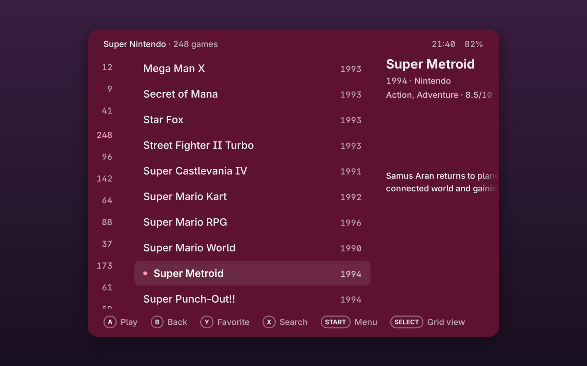</td>
    <td width="50%">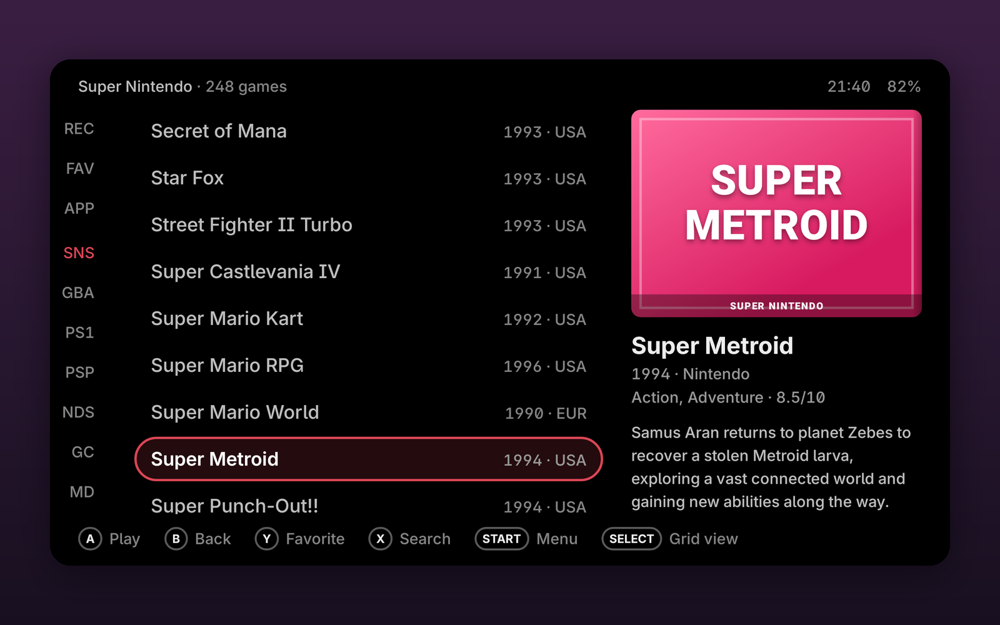</td>
  </tr>
  <tr>
    <td align="center">4:3 screens, like the Retroid Pocket Nova</td>
    <td align="center">Counts, system codes or a letter rail at the edge</td>
  </tr>
  <tr>
    <td width="50%">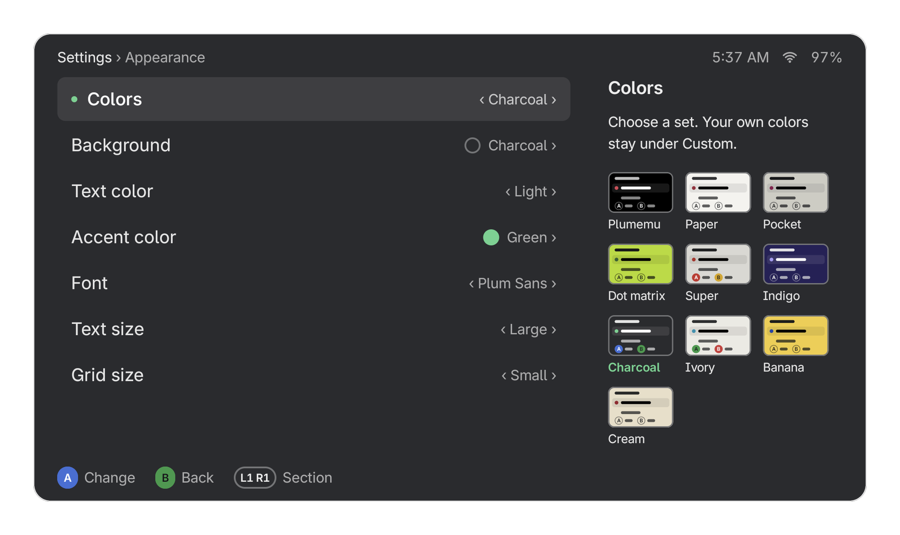</td>
    <td width="50%">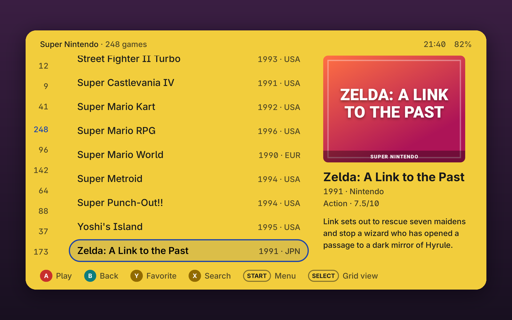</td>
  </tr>
  <tr>
    <td align="center">Ten ready-made color sets</td>
    <td align="center">A, B, X and Y in their classic colors</td>
  </tr>
  <tr>
    <td width="50%">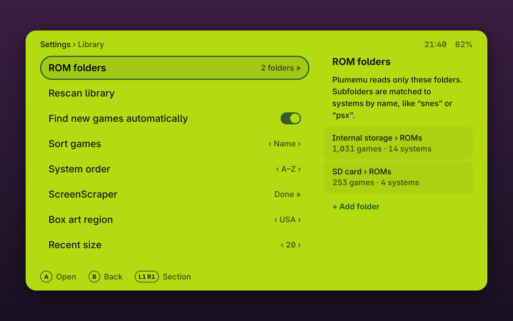</td>
    <td width="50%">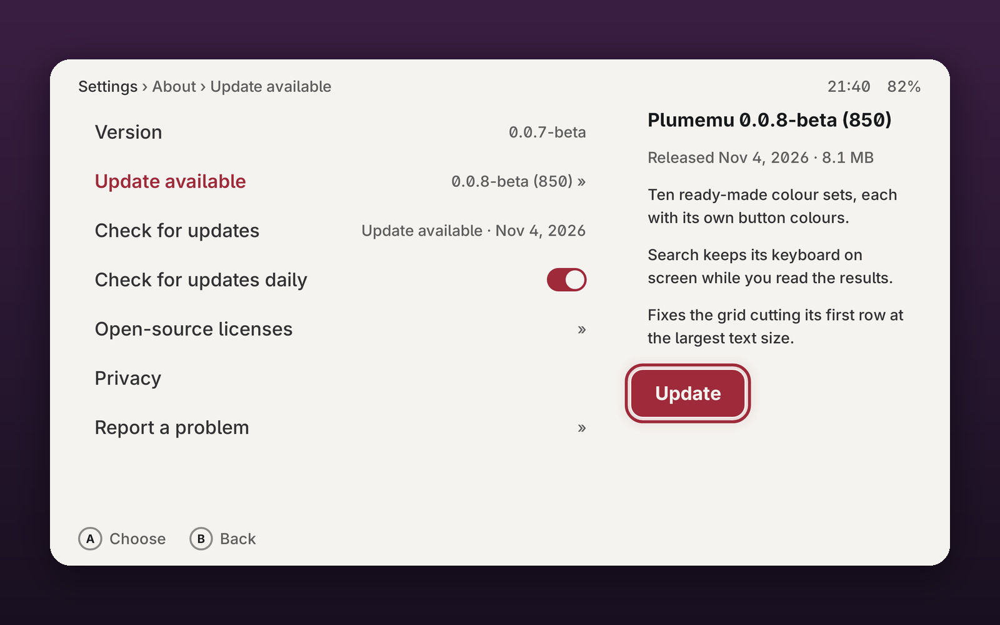</td>
  </tr>
  <tr>
    <td align="center">Settings that say what they do</td>
    <td align="center">Updates from inside the app</td>
  </tr>
</table>

## Light on the hardware

Many retro handhelds are slow and run old Android, so Plumemu is built to use as little as it
can. Measured with 0.0.3-beta (not measured again for 0.0.7-beta) on a slow Android 6.0 emulator (2 GB of memory) with a library of
10,000 games:

| | |
|---|---|
| Download | 8.3 MB |
| Start to your library | 0.24 s |
| Memory | 56 MB |
| CPU while it sits on the home screen | none; the clock redraws once a minute |
| Looking for new games when you come back to Plumemu | usually 12 to 22 ms when nothing changed |
| Running in the background | nothing, except box art downloads you asked for and one read of new game files after a scan |

The battery figures read the battery only while the lower screen's clock shows and the screen is
on: once a second for two minutes, then every ten seconds. On a 24-minute recording of the AYN Thor
at rest, the time left was within 10% of the real one from the first minute, and within 1% after
fifteen minutes.

## Devices

**Tested on** the AYN Thor (both of its screens), the Retroid Pocket Nova (4:3) and the Retroid
Pocket Classic. Plumemu is
laid out for handheld screens from 4.5 to 6 inches in 16:9 and 4:3 (Retroid Pocket 5, 4 Pro and
Mini, AYN Odin, and similar), but those are untested. If you try it on one, a short report under
[Issues](../../issues) helps a lot. A second screen is optional: on the Thor it shows details, a clock and your battery,
and nothing needs it.

This is a beta. It still has gaps and rough edges, and it is updated often.

## Install

1. Download `plumemu-0.0.7-beta-821.apk` from the latest [release](../../releases) or from the
   [website](https://plumemu.stevensdesk.com).
2. Open it on the device and allow the install when Android asks.
3. Open Plumemu and pick your ROMs folder. To make it the home screen, say yes when it asks, or
   press Home and choose Plumemu.

**Updating.** From 0.0.2-alpha, install this version the same way, over the old one; your library
and settings stay. From now on Plumemu finds new versions itself: START Settings shows a dot, and
Settings › About › Update downloads it, checks that it really is Plumemu, and installs it. On
Android 8 and later, Android asks once to let Plumemu install apps. Nothing installs while you
play. Settings › About › Check for updates daily turns the daily check off.

## Controls

| Button | Does |
|---|---|
| A | Open, play |
| B | Back |
| X | Search |
| Y | Add to or remove from Favorites |
| START | Game menu; Settings from the system column |
| SELECT | List or grid (covers, or app icons in Apps) |
| L2 / R2 | Previous / next system |
| L1 / R1 | In a list, previous / next letter; in a game grid, smaller / larger covers |
| Home | With Plumemu as the home screen: back to the game you played last |

The button printed A confirms. Settings › Advanced can make the bottom button (B, or ✕) confirm
instead. Touch works everywhere: tap to select, tap again to play. Settings › Controls › Push
right to play lets one hand do it: push right once to mark a game, again to start it. Pinned shortcuts (Steam,
Windows) start from Plumemu.

On Plumemu's keyboard: A types, B deletes, X is a space, Y switches to numbers, L1 / R1 move the
cursor. Settings › Controls › Keyboard switches to Android's keyboard.

## Not in this beta

- Screenshots and videos of games; box art and details only for now.

## Not included, ever

No games, BIOS files, keys, firmware or emulators. Use files you own; emulators come from their
own developers.

## Translations

Plumemu speaks English, Vietnamese, Spanish, Japanese, Korean and Chinese (Simplified and
Traditional). Most translations have not been read by a native speaker yet. The texts are in
[translations](translations/): report a wrong one with the
[translation template](https://github.com/joiha-steven/plumemu/issues/new?template=translation.yml),
or fix it in a pull request.

## More

- Report a problem or an idea: Settings › About › Report a problem inside the app, or
  [Issues](../../issues) with the Plumemu version (Settings › About), your device and its Android
  version.
- [Guide](GUIDE.md): how to lay out your games folder, BIOS files, emulators, names, settings.
- [Colors](COLORS.md): the ready-made color sets, and how to suggest one.
- [Changelog](CHANGELOG.md): what changed in each version.
- [Privacy](PRIVACY.md)
- [License](LICENSE.md): free to download and use; not open source, all rights reserved.
- [Third-party material](THIRD_PARTY.md): fonts, libraries and data inside the app.
