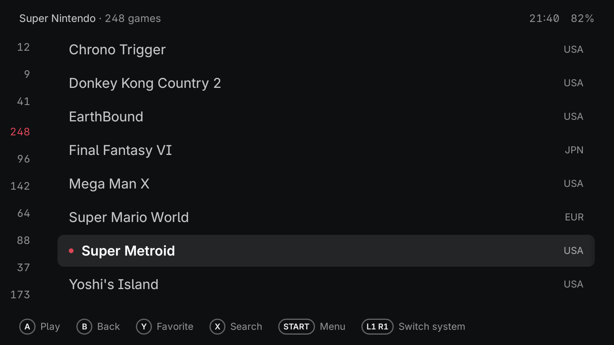
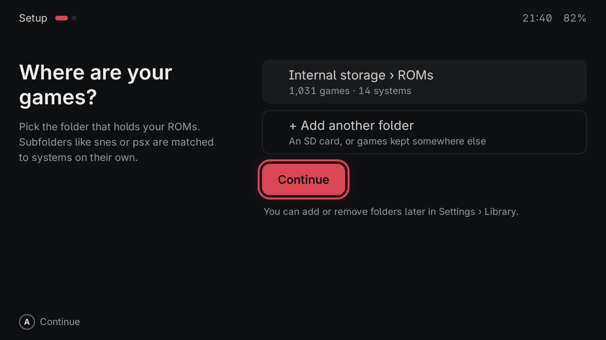
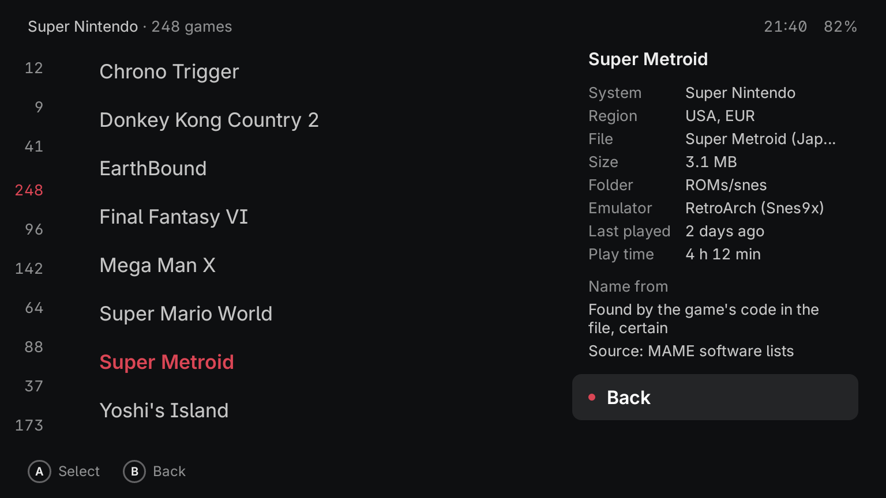
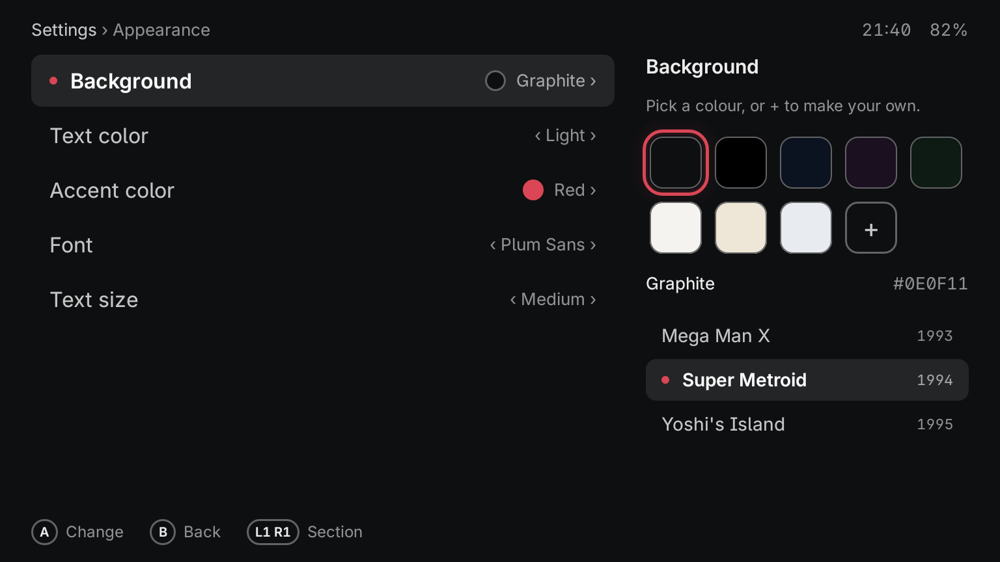
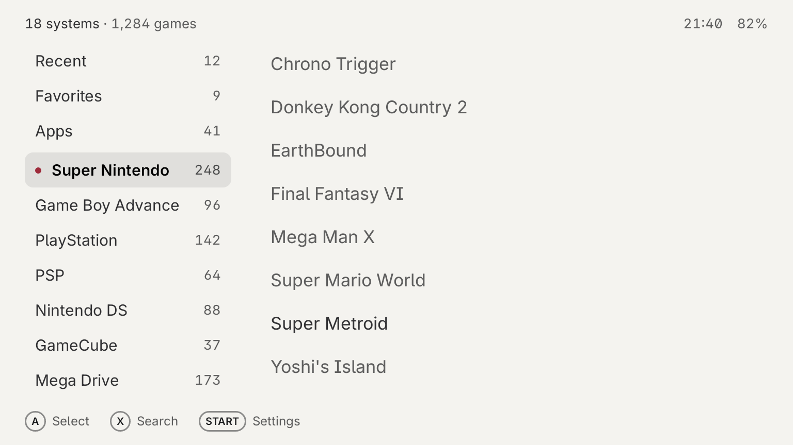

<h1 align="center">Plumemu</h1>

A calm, light launcher for Android retro handhelds.

  

  <b>Alpha 0.0.1</b> · Android 6.0 or later · tested on the AYN Thor only ·
  <a href="../../releases">Download</a>

---

## What it does

- **Two-minute setup.** Pick your ROMs folder in Android's own folder picker. No access to all
  your files, ever.
- **Emulators picked for you.** Plumemu finds the emulators you have installed and picks one per
  system. Any game or system can use another one.
- **Names your games itself, offline.** It reads the game's own code inside zip, 7z and CHD files
  and disc images, knows about 42,000 arcade sets by their short names, and cleans up messy file
  names. No account, no internet. Wrong name? Fix it from the game menu; the fix sticks.
- **One sliding view.** Systems, games and details move as one strip, laid out for 16:9 and 4:3
  screens.
- **Buttons and touch**, equally, everywhere.
- **Your colours.** A background, light or dark text and an accent, used exactly as you pick them.

<table>
  <tr>
    <td></td>
    <td></td>
  </tr>
  <tr>
    <td align="center">Setup in two steps</td>
    <td align="center">Every name says where it came from</td>
  </tr>
  <tr>
    <td></td>
    <td></td>
  </tr>
  <tr>
    <td align="center">Your background, text and accent</td>
    <td align="center">Light or dark, your choice</td>
  </tr>
</table>

## Light on the hardware

Many retro handhelds are slow and run old Android, so Plumemu is built to use as little as it
can. Measured on a slow Android 6.0 emulator (2 GB of memory) with a library of 10,000 games:

| | |
|---|---|
| Download | 3.8 MB |
| Start to your library | 0.2 s |
| Memory | 44–53 MB |
| CPU while it sits on the home screen | none; the clock redraws once a minute |
| Running in the background | nothing |

## Devices

**Tested on the AYN Thor (upper screen) only, the one device I have.** Plumemu is laid out for
handheld screens from 4.5 to 6 inches in 16:9 and 4:3 (Retroid Pocket 5, 4 Pro, Mini and Nova,
AYN Odin, and similar), but those are untested. If you try it on one, a short report under
[Issues](../../issues) helps a lot. Plumemu uses one screen.

## Install

1. Download `plumemu-0.0.1-alpha.apk` from the latest [release](../../releases).
2. Open it on the device and allow the install when Android asks.
3. Open Plumemu and pick your ROMs folder. To make it the home screen, say yes when it asks, or
   press Home and choose Plumemu.

## Controls

| Button | Does |
|---|---|
| A | Open, play |
| B | Back |
| X | Search |
| Y | Add to or remove from Favorites |
| START | Game menu; Settings from the system column |
| L1 / R1 | Previous / next system |

The button printed A confirms. Settings › Advanced can make the bottom button (B, or ✕) confirm
instead. Touch works everywhere: tap to select, tap again to play.

## Not in this alpha

- Box art and game details (they come with ScreenScraper, using your own account).
- Languages other than English.
- More name lists: for now names come from MAME's data, the game's own code and the file name.

## Not included, ever

No games, BIOS files, keys, firmware or emulators. Use files you own; emulators come from their
own developers.

## More

- Report a problem or an idea: [Issues](../../issues), with the Plumemu version (Settings ›
  About), your device and its Android version.
- [Privacy](PRIVACY.md): this alpha sends nothing anywhere.
- [Licence](LICENSE.md): free to download and use; not open source, all rights reserved.
- [Third-party material](THIRD_PARTY.md): fonts, libraries and data inside the app.
